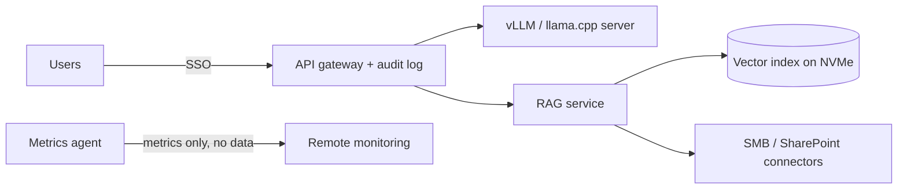

# Architecture — private-ai-box

## 1. Scope
Configure, price and deliver on-prem LLM appliances for firms that won't use cloud AI.
**MVP:** sizing math (weights + KV cache + overhead), bandwidth-bound decode throughput, cheapest
GPU × count search, BOM and compliance packs.
**Product:** configurator web app, pre-imaged appliance OS, remote metrics-only monitoring, financing and TCO.

## 2. Sizing model
- **VRAM** = `(params × bytes_per_weight + KV) × 1.10`, where
  `KV = 2 × layers × kv_heads × head_dim × 2 B × context × concurrent_sequences` (fp16 KV, GQA-aware).
- **Decode tokens/s** ≈ `bandwidth × 0.6 / (active_params × bytes_per_weight)`, which is memory-bound.
  Tensor parallel scales at 85% per extra GPU. MoE uses *active* params, which is why a 120B MoE out-runs a 70B dense model.
- **Per-user tokens/s** = aggregate × batch gain (`1 + 0.6·(n−1)`, saturating) / n.
- Search: for each GPU, the smallest count in {1, 2, 4, 8} that satisfies both VRAM and per-user
  tokens/s, then sort by GPU cost.

## 3. Design decisions
- **First-principles formulas over benchmark lookup tables.** They generalise to new models and
  cards instantly, and the efficiency constants get calibrated against measured runs (roadmap:
  ship a calibration harness with the appliance).
- **Both constraints have to hold.** Cheap cards that fit VRAM but miss latency are excluded,
  because they generate support tickets.
- **Placeholder list prices, clearly labelled.** Real quotes come from distributor feeds.

## 4. Appliance architecture (product)

Hardening: LUKS + TPM, no WAN route from the model VLAN (air-gapped profile), and signed offline
update bundles.

## 5. Risks
Hardware supply and price volatility, so quotes expire after 7 days. Model licence terms for
commercial on-prem use are checked per model in the catalogue.
